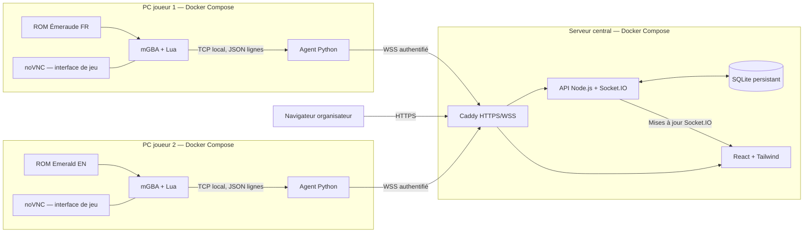

# 🏁 Pokérace Tracker

**Dashboard web en temps réel pour une course Pokémon Émeraude entre amis.** Chaque participant joue sur sa propre machine avec mGBA. Un extracteur Lua lit les informations du jeu, un agent local les envoie au serveur et un dashboard affiche les dresseurs, leur position et leurs équipes avec les sprites des Pokémon.

> **Statut : cahier des charges / README cible.** Ce document définit le comportement attendu du projet à développer avec Codex. Il ne signifie pas que le code, les images Docker ou les profils mémoire sont déjà implémentés ou validés.

## ✨ Fonctionnalités prévues (MVP)

- Voir les joueurs connectés et déconnectés, leur dernière activité et leur version de jeu.
- Afficher leur nom de dresseur, leur ville ou zone actuelle et leurs six emplacements d'équipe.
- Afficher pour chaque Pokémon son sprite, son nom localisé, son niveau, ses PV et son statut chromatique, lorsque ces données sont disponibles et validées.
- Mettre à jour automatiquement le dashboard par WebSocket, sans actualisation de page.
- Conserver le dernier état connu de chaque joueur et le retrouver après un redémarrage du serveur.
- Gérer des joueurs utilisant **simultanément Pokémon Émeraude FR et EN**.
- Conteneuriser tous les services : serveur, frontend, reverse proxy, agent et mGBA avec une interface de jeu accessible via navigateur (noVNC).

## 🌍 Compatibilité des ROM

**Objectif : prendre en charge toutes les éditions officielles identifiées de Pokémon Émeraude en français et en anglais**, y compris leurs révisions lorsqu'elles existent et que leurs profils ont été validés. Cela ne doit pas être implémenté en supposant que toutes les éditions partagent les mêmes adresses mémoire.

| Édition | Prise en charge attendue | Validation nécessaire |
| --- | --- | --- |
| Pokémon Émeraude (France, FR) | Oui | Profil mémoire et tables de texte FR |
| Pokémon Emerald (USA, EN) | Oui | Profil mémoire et tables de texte EN |
| Pokémon Emerald (Europe, EN) | Oui, si édition/révision distincte identifiée | Empreinte et profil dédiés si nécessaire |
| Révisions officielles FR/EN | Oui, après identification et validation | Profil ou alias vérifié pour chaque révision |
| ROM hacks, randomizers modifiant les données, traductions non officielles | Non garantis | Adaptateur spécifique ou validation explicite |

### Identification et sécurité de la lecture

Au démarrage, le client calcule le **SHA-256** du fichier ROM monté en lecture seule et lit son en-tête GBA (titre, code de jeu, région/version lorsque disponibles). L'en-tête aide à l'identification, mais **ne suffit pas à prouver l'identité exacte d'une révision** : le SHA-256 est comparé à un registre maintenu dans le dépôt (`emulator/profiles/rom-manifest.json`). N'y inscrire que les empreintes réellement vérifiées ; ne pas inventer de hash.

Chaque entrée du manifeste référence un profil (`emerald-fr-*`, `emerald-en-*`) contenant les adresses ou méthodes de découverte, la disposition des structures, le décodage des chaînes et les tables de cartes propres à cette version. Deux ROM peuvent partager un profil **uniquement si leur compatibilité a été testée**. Conserver les identifiants numériques de cartes et d'espèces indépendamment de leurs noms affichés.

Si l'empreinte est inconnue, afficher **« ROM non reconnue »**, sa métadonnée d'en-tête et son SHA-256 pour diagnostic. **Ne pas lire la mémoire avec un profil approximatif** et ne pas afficher de données inventées. Prévoir un mécanisme explicite pour ajouter et valider des profils. La détection de révision ne doit pas être confondue avec celle de la langue.

**Les fichiers ROM, BIOS et sauvegardes ne sont ni fournis ni distribués par ce projet.** Chaque participant fournit ses propres fichiers.

## 🏗️ Architecture



Le script Lua **lit seulement la mémoire** : aucune écriture en RAM, automatisation du jeu ou modification de sauvegarde n'est requise. Il envoie ses données au service agent par une connexion TCP **interne au réseau Docker du joueur**. L'agent valide le format, gère les reconnexions et transmet au serveur par WSS. L'agent ne doit jamais ouvrir un port public.

## 🧰 Stack technique

| Couche | Technologie |
| --- | --- |
| Émulation | mGBA, version épinglée et compilation avec support Lua vérifiée |
| Extraction | Lua, API de scripting mGBA |
| Agent local | Python 3.12, Pydantic et client Socket.IO |
| API / temps réel | Node.js, TypeScript, Express et Socket.IO |
| Interface web | React, TypeScript, Vite, Tailwind CSS |
| Stockage | SQLite avec volume Docker persistant |
| Proxy / TLS | Caddy, HTTPS et WSS |
| Interface graphique de l'émulateur | Serveur X virtuel + VNC/noVNC, ou solution équivalente testée |
| Déploiement | Deux projets Docker Compose indépendants |

**Attention à mGBA dans Docker :** la compilation retenue doit exposer le moteur Lua et permettre son chargement automatique. Le son, les manettes et les performances de l'interface distante doivent être testés selon l'OS des joueurs. noVNC peut être limité sur certains navigateurs et configurations clavier/manette ; il ne faut pas promettre une expérience identique à l'application native sans tests.

## 📁 Arborescence cible

```text
pokerace-tracker/
├── apps/
│   ├── api/                     # API Express, Socket.IO, SQLite
│   ├── web/                     # Dashboard React
│   └── agent/                   # Client Python pour chaque joueur
├── emulator/
│   ├── lua/                     # Lecture RAM et protocole TCP
│   ├── profiles/                # Profils FR/EN + manifeste des ROM
│   │   ├── rom-manifest.json
│   │   ├── emerald-fr/
│   │   └── emerald-en/
│   └── docker/                  # mGBA + interface noVNC
├── packages/
│   └── shared/                  # Schémas des événements et contrats JSON
├── assets/
│   └── sprites/                 # Sprites autorisés ou mis en cache
├── deploy/
│   ├── server/                  # compose.yaml, Caddyfile, .env.example
│   └── player/                  # compose.yaml, .env.example
├── docs/
│   ├── rom-compatibility.md
│   ├── memory-profiles.md
│   └── protocol.md
├── tests/
├── scripts/
└── README.md
```

## 🚀 Installation du serveur (cible une fois Codex terminé)

**Prérequis :** Docker Engine et Docker Compose v2 ; un hôte accessible depuis les PC des joueurs. Pour HTTPS public automatique, disposer d'un nom de domaine pointant vers le serveur et des ports 80/443 accessibles.

```bash
git clone <URL_DU_DEPOT>
cd pokerace-tracker
cp deploy/server/.env.example deploy/server/.env
# Modifier les valeurs dans deploy/server/.env
cd deploy/server
docker compose up -d --build
```

Configuration serveur prévue :

```dotenv
PUBLIC_DOMAIN=race.example.com
DATABASE_PATH=/data/pokerace.sqlite
CORS_ORIGIN=https://race.example.com
ADMIN_TOKEN=replace-with-a-long-random-secret
```

Le dashboard sera accessible à `https://race.example.com`. Mettre en place la création d'identifiants de clients individuels et une interface ou commande d'administration ; ne jamais partager le token administrateur avec les joueurs. En développement local, prévoir une configuration HTTP séparée et documentée.

## 🎮 Installation sur chaque PC joueur (cible)

1. Installer Docker Desktop ou Docker Engine avec Compose.
2. Placer sa ROM personnelle dans `deploy/player/roms/` (répertoire ignoré par Git).
3. Copier `deploy/player/.env.example` vers `deploy/player/.env` et renseigner l'URL du serveur, l'identifiant et le jeton **propres à ce joueur**, ainsi que le nom de fichier ROM.
4. Démarrer les conteneurs puis ouvrir l'interface noVNC locale pour jouer.

```bash
cd deploy/player
cp .env.example .env
# Ajouter sa ROM dans roms/ et renseigner .env
docker compose up -d --build
```

Exemple de configuration :

```dotenv
SERVER_URL=https://race.example.com
PLAYER_ID=joueur-01
PLAYER_TOKEN=replace-with-this-players-unique-secret
ROM_FILE=Pokemon_Emeraude_FR.gba
NOVNC_PORT=6080
```

Le fichier Compose doit monter `./roms` **en lecture seule**, isoler les fichiers de sauvegarde dans un volume persistant distinct et publier noVNC **uniquement sur `127.0.0.1:6080`** par défaut. URL locale attendue : `http://127.0.0.1:6080`. Documenter toute exposition réseau supplémentaire. Ne jamais transférer la ROM ni le fichier de sauvegarde au serveur central.

La configuration doit sélectionner automatiquement le profil ROM au démarrage ; **aucun réglage manuel FR/EN ne doit être nécessaire** lorsque l'empreinte est connue. Deux participants jouant avec des langues différentes apparaissent dans une même course.

## 📡 Données échangées

Schéma JSON illustratif ; les données chiffrées de l'espèce, les offsets et la carte sont extraits selon le **profil détecté**. Le protocole de production doit être versionné et validé côté agent et serveur.

```json
{
  "protocolVersion": 1,
  "playerId": "joueur-01",
  "game": {
    "name": "pokemon-emerald",
    "language": "fr",
    "profileId": "emerald-fr-verified-profile"
  },
  "trainer": { "name": "ALEX" },
  "location": {
    "mapGroup": 0,
    "mapNumber": 0,
    "label": "BOURG-EN-VOL"
  },
  "party": [
    {
      "slot": 1,
      "speciesId": 252,
      "speciesName": "Arcko",
      "level": 12,
      "currentHp": 28,
      "maxHp": 34,
      "shiny": false
    }
  ],
  "observedAt": "2026-09-25T12:00:00Z"
}
```

Les valeurs ci-dessus sont **un exemple fictif**, pas des adresses ni un résultat d'extraction vérifié. Le serveur ajoute l'heure de réception ; il ne doit pas se fier exclusivement à l'horloge du joueur. Ne pas transmettre de SHA-256 complet au dashboard public si ce n'est pas nécessaire au diagnostic.

### Extraction mémoire

- Récupérer le nom du joueur et décoder correctement l'alphabet Pokémon de la version FR/EN, **sans supposer de l'ASCII ou de l'UTF-8 directement en RAM**.
- Lire les six emplacements de l'équipe : identifiant d'espèce, surnom facultatif, niveau, PV, indicateur chromatique ; interpréter correctement la structure et la permutation/chiffrement des sous-structures Pokémon.
- Lire les identifiants numériques de carte/zone et traduire le nom affiché avec une table **propre à la version** ; en cas d'inconnu, afficher « Zone inconnue » avec les identifiants pour diagnostic.
- Vérifier les pointeurs RAM et la plausibilité des valeurs à chaque lecture ; ne jamais afficher de Pokémon fantômes pendant un chargement, un changement de carte ou avant le début d'une partie.
- Échantillonner périodiquement (par exemple chaque seconde) et n'émettre un état complet que lorsqu'il change ; envoyer un heartbeat régulier pour maintenir le statut en ligne.
- Gérer la perte du socket et l'arrêt/redémarrage de mGBA sans faire planter l'agent.

## 🖼️ Sprites des Pokémon

Utiliser les sprites pixel-art de la génération 3 pour représenter l'équipe. Source candidate : [PokéAPI Sprites](https://github.com/PokeAPI/sprites), sous réserve de vérifier les conditions d'utilisation et les droits applicables aux ressources graphiques. Une copie locale ou un cache évite de rendre le dashboard dépendant d'appels externes à chaque affichage.

- Indexer les sprites par **identifiant national de l'espèce**, et non par nom localisé : `252` affiche Arcko aussi bien pour un joueur FR qu'un joueur EN.
- Prévoir les variantes normales et chromatiques lorsqu'elles existent.
- Conserver le rendu net du pixel-art (`image-rendering: pixelated`).
- Prévoir une image de remplacement si le sprite n'est pas disponible et un état visuel pour les emplacements vides.
- Ne pas supposer que tous les chemins de sprites ou toutes les variantes existent : utiliser un manifeste d'assets vérifié lors du build.

## 🖥️ Dashboard

Une page principale responsive affiche une carte par participant :

- statut **En ligne / Hors ligne** et temps écoulé depuis la dernière mise à jour ;
- nom du dresseur, langue et révision reconnue ;
- nom de la ville ou zone actuelle ;
- six emplacements d'équipe avec sprites et noms localisés, niveau et barre de PV ;
- indicateur chromatique et message visible si la ROM n'est pas reconnue ou si le jeu n'a pas encore démarré.

Afficher la dernière donnée connue d'un client déconnecté **avec une étiquette « Dernière donnée reçue »**, pour ne pas la présenter comme un état actuel. Prévoir une vue agréable sur mobile et desktop, un mode sombre et un affichage clairement lisible pour un stream.

## 🔐 Sécurité et confidentialité

- Un token individuel par joueur ; authentifier les connexions agents et autoriser chaque client à ne publier que **son propre état**.
- Valider tous les messages et limiter leur taille, leur fréquence et les champs acceptés ; le backend ne doit pas accepter sans contrôle un nom d'espèce ou une URL de sprite arbitraire.
- HTTPS/WSS en production ; pas de token dans les URL, dans le frontend public ni dans les logs.
- Pas de port TCP Lua accessible depuis Internet ; pas de port SQLite exposé ; noVNC lié à localhost par défaut.
- Ignorer dans Git `.env`, `roms/`, `saves/`, bases locales, fichiers de logs et secrets.
- Prévoir des sauvegardes régulières de SQLite et des migrations versionnées.

## ✅ Critères de validation avant de déclarer le MVP terminé

- [ ] `docker compose up -d --build` lance le serveur sans dépendances installées sur l'hôte en dehors de Docker.
- [ ] Le Compose joueur démarre mGBA, le moteur Lua, l'agent Python et l'interface noVNC ; les contrôles du jeu fonctionnent sur les OS explicitement annoncés comme supportés.
- [ ] Les profils FR et EN sont reliés à des empreintes de ROM réellement vérifiées, documentées et testées ; toutes les révisions annoncées comme compatibles ont des cas de test.
- [ ] Une ROM FR et une ROM EN peuvent être connectées **simultanément** à la même course.
- [ ] Les noms accentués, la ville, les identifiants d'espèce et les six emplacements sont correctement décodés pour les deux langues.
- [ ] Les données d'un Pokémon chiffré/permuté sont correctement lues ; les valeurs invalides sont rejetées.
- [ ] Les sprites normaux et chromatiques affichés correspondent aux identifiants d'espèce, sans dépendre de la langue.
- [ ] Un client déconnecté passe hors ligne après le délai configuré et conserve visuellement son dernier état connu.
- [ ] Les redémarrages des conteneurs n'effacent ni les sauvegardes des joueurs ni les derniers états côté serveur.
- [ ] Une ROM inconnue produit un diagnostic explicite et ne déclenche aucune lecture mémoire hasardeuse.
- [ ] Des tests automatisés couvrent les profils, les schémas JSON, l'authentification, la reconnexion et les mises à jour Socket.IO.

## 📚 Références techniques

- [mGBA — API officielle de scripting](https://mgba.io/docs/scripting.html)
- [mGBA — API de développement](https://mgba.io/docs/dev/scripting.html)
- [pret/pokeemerald — décompilation de référence](https://github.com/pret/pokeemerald)
- [PokéAPI — ressources de sprites](https://github.com/PokeAPI/sprites)

> **Note à Codex :** réaliser le projet conformément à ce README. Ne jamais marquer « compatible » une révision FR/EN non identifiée ou non testée ; faire ressortir les points bloquants, les tests manquants et les limites de la solution graphique Docker. Les commandes ci-dessus décrivent le fonctionnement cible et doivent devenir exécutables après implémentation.
